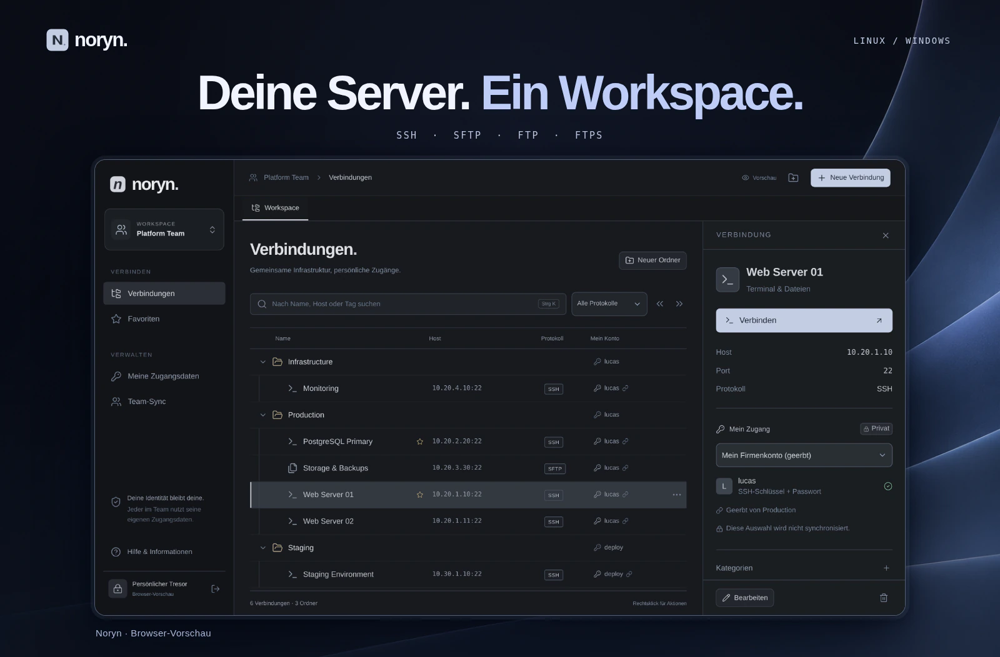

# Noryn

**Dein Desktop-Workspace für Server und Dateien.**

**SSH · [RDP](#remote-desktop) · SFTP · FTP · FTPS**

Öffne SSH- und Remote-Desktop-Sitzungen, übertrage Dateien und organisiere deine Server in privaten oder gemeinsamen Workspaces. Mit Noryn kann dein Team denselben Verbindungsbaum nutzen, während jeder sich mit seinem eigenen Konto anmeldet.

[Jetzt ausprobieren](#ausprobieren) · [Team-Sync einrichten](docs/setup.md#team-sync) · [Feedback geben](https://github.com/Lucas-Gruber/noryn/issues)



## Was du mit Noryn machen kannst

- **Server organisieren.** Lege verschachtelte Ordner an, filtere nach Protokoll und finde wichtige Hosts über Favoriten, Tags und Suche wieder. Zugangsdaten lassen sich vom Ordner an seine Verbindungen vererben.
- **Per SSH arbeiten.** Öffne mehrere Terminal-Tabs und nutze den Dateibrowser in derselben Sitzung. Terminal und Dateien teilen sich die Anmeldung, auch wenn der Server einen Einmalcode abfragt.
- **Remote-Desktops öffnen.** Starte RDP-Sitzungen aus deinem Verbindungsbaum.
- **Dateien übertragen.** Ziehe Dateien zwischen lokalen und entfernten Ordnern, verfolge Transfers in der Warteschlange und speichere Startpfade für SFTP-, FTP- und FTPS-Verbindungen.
- **SSH-Sitzungen verwalten.** Richte lokale TCP-Portweiterleitungen ein und sieh dir Prozesse, Dienste und Hardwaredaten auf unterstützten Linux-Hosts an.

[SSH-Terminal ansehen](docs/terminal-workspace-preview.png) · [Dateibrowser ansehen](docs/files-preview.png) · [Systemübersicht ansehen](docs/ssh-system-preview.png)

## Gemeinsam arbeiten

Lege für dein Team einen Workspace mit seinen Hosts, Ordnern und Notizen an. Noryn synchronisiert den Baum auf Knopfdruck über einen selbst gehosteten Server. Die Daten werden vor dem Upload auf dem Gerät verschlüsselt.

Persönliche Konten und ihre Zuordnungen liegen im lokalen verschlüsselten Tresor. Ein gemeinsam genutztes Konto kannst du gezielt für einen Team-Workspace freigeben. Der private Workspace funktioniert auch ohne Sync-Server.

## Ausprobieren

Noryn ist ein frühes Desktop-Projekt für Linux und Windows. Der Einstieg erfolgt über den Quellcode.

### Browser-Vorschau

Du brauchst [Node.js 22.13 oder neuer](https://nodejs.org/) und [pnpm 11](https://pnpm.io/installation).

```sh
git clone https://github.com/Lucas-Gruber/noryn.git
cd noryn
pnpm install --frozen-lockfile
pnpm dev
```

Öffne [localhost:1420](http://127.0.0.1:1420). Die Vorschau simuliert Sitzungen und Transfers mit flüchtigen Beispieldaten. Echte Verbindungen laufen über die Desktop-App.

### Desktop-App

Installiere zusätzlich Rust stable, Perl für den OpenSSL-Build und die [Tauri-Systemabhängigkeiten](https://v2.tauri.app/start/prerequisites/). Starte die App aus dem Projektordner.

```sh
pnpm tauri dev
```

Erstelle beim ersten Start deinen Tresor, hinterlege ein Konto unter **Meine Zugangsdaten** und weise es einer Verbindung oder einem Ordner zu. Prüfe vor der ersten SSH-Anmeldung den Host-Fingerabdruck.

## Projektstatus

Unterstützt werden SSH, RDP, SFTP, FTP und explizites FTPS. Der Team-Sync erfolgt manuell und erkennt konkurrierende Änderungen. Änderungen aus Konflikten müssen von Hand zusammengeführt werden.

### Remote Desktop

RDP ist verfügbar. VNC-Sitzungen sind geplant.

Gebaut mit Tauri 2, Vue 3, TypeScript, Rust und xterm.js.

[Setup, Builds und Tests](docs/setup.md) · [Architektur und Sicherheitsgrenzen](docs/architecture.md) · [Issues und Ideen](https://github.com/Lucas-Gruber/noryn/issues)
